# ORG Reading Room, public

*The public shelf of the Octagon Religious Research Group: the decks, procedures and proposals ORG has chosen to share.*

**Read it in your browser:** <https://octagon-religious-research-group-org.github.io/reading-room-public/>

## What this is

ORG keeps a private **reading room** where its members read drafts before they are public. This repository is its public
half. It serves one page, [`index.html`](index.html), with GitHub Pages: the decks, ORG's public procedures, and how to
ask for the members' room. No build step, nothing to install.

## How things get here

- Only paths an officer has written into the private room's `PUBLIC-ALLOWLIST.txt` arrive here, copied by a workflow
  after two automatic checks: one for names, keys and private notes, then one that reads every file, PDFs included.
  On 2026-11-01, 000 Start here and the universal procedures were proposed for the list; they arrive after an officer's
  yes and the first sync, and the page shows each one as "not published yet" until then.
- **The members' room** is <https://github.com/Octagon-Religious-Research-Group-ORG/reading-room>: the access point for
  members. Visitors see GitHub's "page not found" there; the page explains how to ask.
- **Nobody edits this repository by hand.** To change what is here, change the private room's allowlist or content. The
  page itself (`index.html`) and this README are this repository's own and are never overwritten by the sync.
- `main` carries a deletion-only ruleset: it cannot be deleted, and the sync can still publish.

## Elsewhere

[orgspirituality.org](https://orgspirituality.org) ·
[Entry portal](https://octagon-religious-research-group-org.github.io/) ·
[ORG AstroLog](https://octagon-religious-research-group-org.github.io/changelog-astro-public/) ·
[ORG procedures, public](https://github.com/Octagon-Religious-Research-Group-ORG/ops-standard-operating-procedures-public) ·
[Contacts](https://github.com/Octagon-Religious-Research-Group-ORG/.github/blob/main/CONTACTS.md)

Written content: CC BY-SA 4.0 (see ORG's <a href="https://github.com/Octagon-Religious-Research-Group-ORG/.github/blob/main/LICENSE-CONTENT">LICENSE-CONTENT</a>). ORG's names and marks are reserved. Icons: Lucide (ISC).
